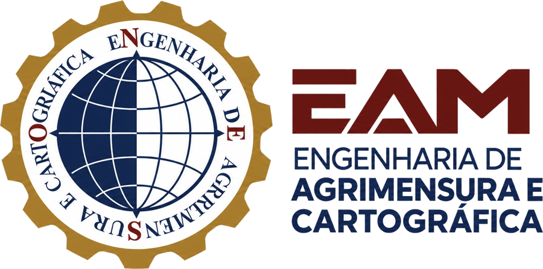
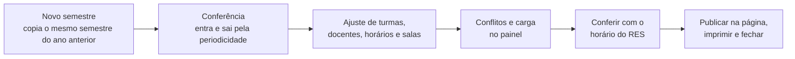

# Oferta de Disciplinas EAM

Sistema para planejar, a cada semestre, a oferta de disciplinas do curso de Engenharia de Agrimensura e
Cartográfica da UFV: turmas, horários, salas e carga docente. Substitui a planilha de distribuição de aulas.

A página inicial é aberta: qualquer pessoa consulta as disciplinas ofertadas, a semana de cada período e o horário do
LEA. O painel e as alterações são restritos aos docentes do curso, com a conta Google @ufv.br.

## O que faz

- **Página inicial pública** com a oferta dos semestres publicados: disciplinas e turmas, horários, salas e docentes,
  grade semanal de cada período e horário do LEA para imprimir.
- **Painel** interativo: indicadores, gráficos de rosca e filtros cruzados (nível, tipo de aula, local, docente),
  carga por docente (graduação e pós, com o mínimo de 8 h), mapa das aulas simultâneas com as turmas de cada hora,
  conflitos e pendências.
- **Turmas**: inclui, edita, duplica e exclui turmas, com aviso de conflito enquanto edita. Em turma com mais de um
  docente, as horas são divididas igualmente ou conforme o informado para cada um.
- **Grades horárias** geral, por docente, por sala e por período da matriz, prontas para imprimir.
- **Salas e LEA**: ocupação das salas do LEA, do CCE e dos pavilhões; impressão da grade consolidada ou
  de uma página por sala.
- **Conferência**: o que entrou e saiu em relação ao mesmo semestre do ano anterior, disciplinas esperadas
  pela periodicidade (1º semestre, 2º semestre, todo semestre) e comparação com o horário oficial do Registro Escolar (RES).
- **Disciplinas**: catálogo com a periodicidade e o histórico de oferta desde 2022.
- **Semestres**: cada novo semestre começa como cópia de outro; o administrador fecha, reabre e exclui.
- **Histórico** de toda alteração, com autor e data, que não pode ser apagado.

Parte técnica

React 19, TypeScript e Vite 8; banco e login no Supabase (PostgreSQL); publicação no GitHub Pages pelo ramo
`gh-pages`.

- Sem `.env`, o site roda em **modo demonstração**: horários reais da DTI e docentes fictícios, com os dados
  guardados só no navegador.
- `npm run dti` baixa o horário EAM do Registro Escolar, publicado no site da DTI (2022 em diante), e gera
  `src/dados/dti.json` e `db/003_dados_dti.sql`.
- `npm run planilhas` lê as planilhas de distribuição em `dados-fonte/privado/` (fora do git) e gera
  `db/privado/004_docentes.sql` e a distribuição fictícia da demonstração.
- Banco: `db/001_esquema.sql` (tabelas), `db/002_regras.sql` (funções e permissões). Toda escrita passa
  por funções `security definer`; RLS em todas as tabelas; histórico imutável.
- `npm run db:teste` percorre as regras num PostgreSQL local; `npm run db:supabase` junta os scripts para o
  SQL Editor.
- `npm run publicar` gera o site e envia para o ramo `gh-pages`.

---

Desenvolvido por Prof. Dr. Darlan Miranda Nunes | Departamento de Engenharia Civil | Universidade Federal de Viçosa
